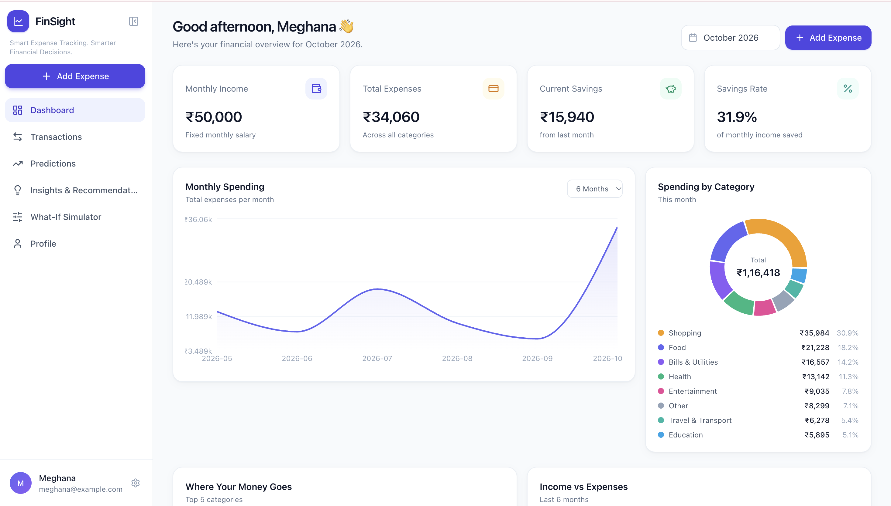
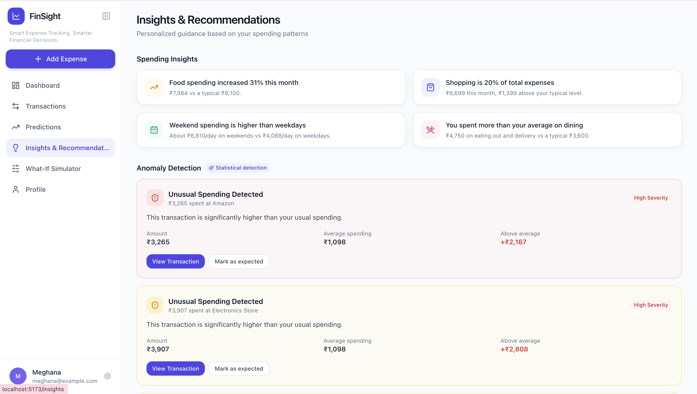
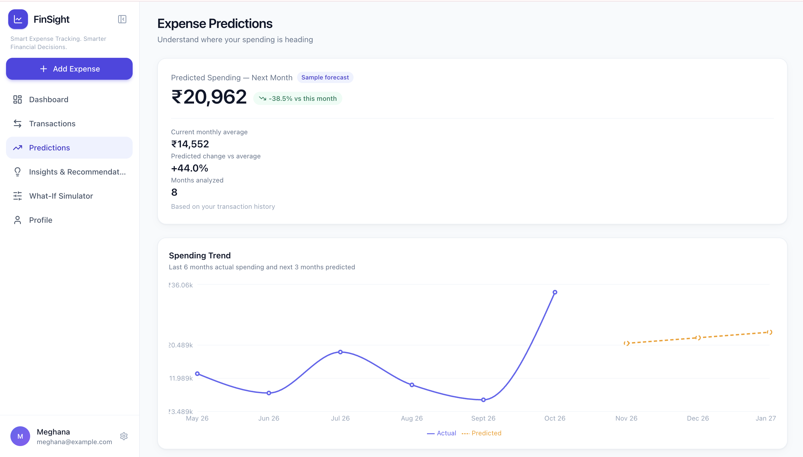
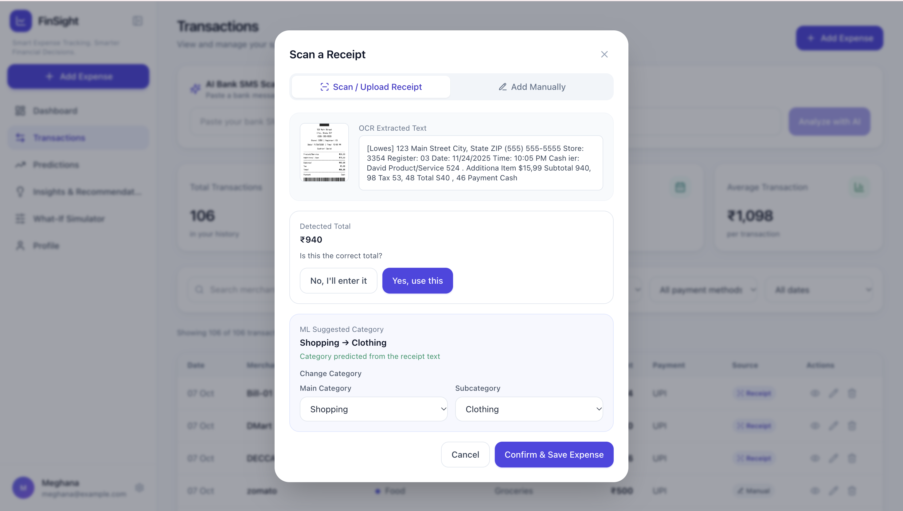
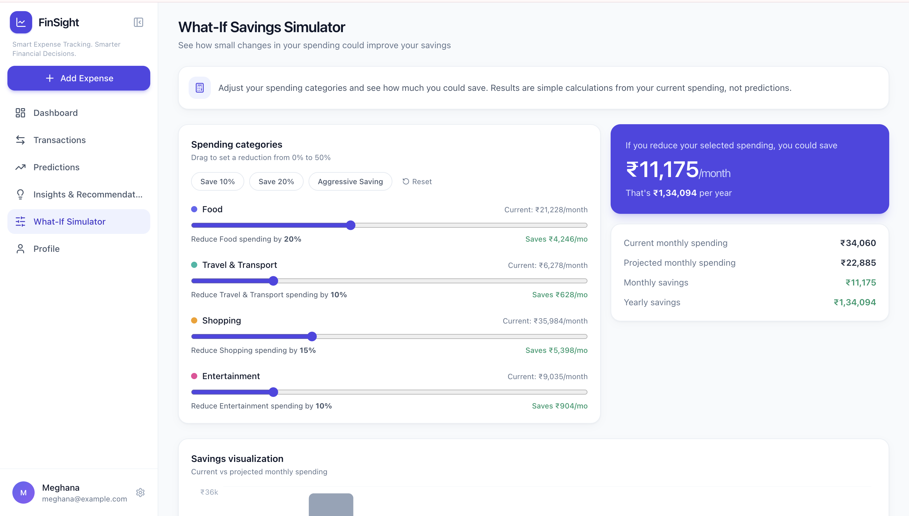
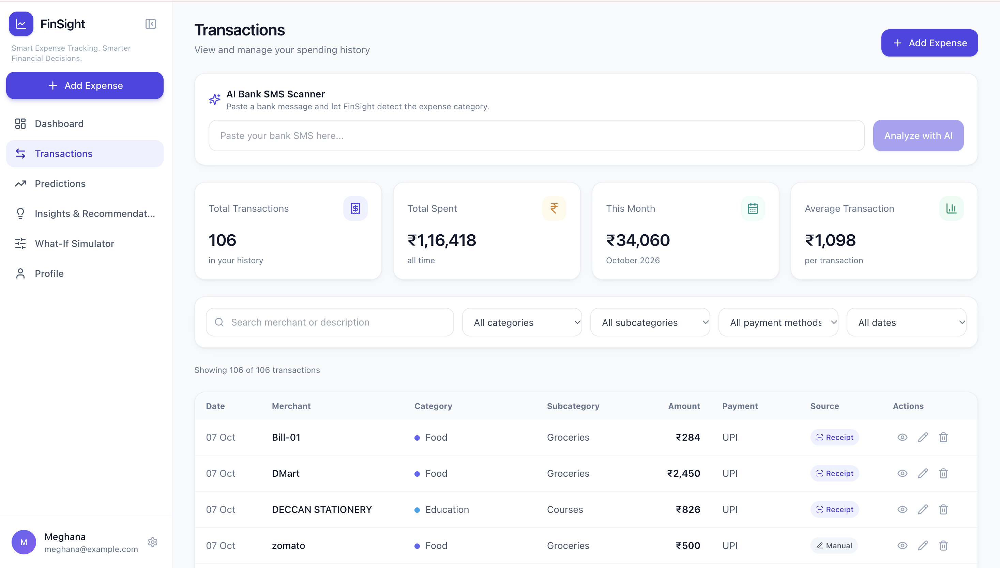

# FinSight — Smart Expense Tracker & AI Financial Advisor

A full-stack expense tracking application that helps users record expenses, analyze spending patterns, view category-wise breakdowns, forecast future expenses, and receive personalized financial insights.

# FinSight — Smart Expense Tracker & AI Financial Advisor

FinSight is a personal finance application designed to help users record transactions, understand spending patterns, and explore expense predictions. It combines a web-based interface, a Python API, a PostgreSQL database, and machine-learning components for expense categorization and forecasting.

> **Documentation note:** This README is a project overview prepared from the information currently available. Verify feature completeness, dataset roles, exact API routes, and evaluation results against the latest code before treating every detail as final.

## Table of Contents

- [Project Overview](#project-overview)
- [Objectives](#objectives)
- [Features](#features)
- [Technology Stack](#technology-stack)
- [Machine Learning Components](#machine-learning-components)
- [Datasets and Data Sources](#datasets-and-data-sources)
- [System Architecture](#system-architecture)
- [Application Workflow](#application-workflow)
- [Database](#database)
- [Project Structure](#project-structure)
- [Running the Project Locally](#running-the-project-locally)
- [Evaluation and Testing](#evaluation-and-testing)
- [Limitations and Future Scope](#limitations-and-future-scope)
- [Screenshots](#screenshots)

## Project Overview

Managing personal expenses manually can make it difficult to understand where money is going and how spending may change over time. FinSight aims to bring transaction recording, category-wise spending analysis, receipt text extraction, and expense forecasting into one application.

The project is intended as a combined **Machine Learning (ML) and Full-Stack Development (FSD)** case study.

## Objectives

- Provide a central place to record and review personal transactions.
- Summarize income, expenses, savings, and savings rate.
- Categorize transaction descriptions using a trained text-classification model.
- Extract text from receipt images using OCR to assist transaction entry.
- Present spending patterns through dashboard visualizations.
- Explore future expense trends using a forecasting model.
- Demonstrate integration between a React frontend, FastAPI backend, PostgreSQL database, and Python ML components.

## Features

The project has been described as including the following screens and workflows. Confirm each feature against the latest running application before marking it as fully implemented.

- **Dashboard:** Summary cards and spending visualizations.
- **Transactions:** View and manage transaction records.
- **Expense categorization:** Suggest a category from transaction text.
- **Receipt OCR:** Extract text from an uploaded receipt and use it to assist transaction entry.
- **Predictions:** Display historical spending and forecasted expenses.
- **Insights:** Present spending patterns and summaries.
- **Simulator:** Explore hypothetical changes, if the current implementation supports them.
- **Profile:** Display or edit profile-related information, if implemented.

### Receipt-to-transaction workflow

1. The user uploads a receipt image.
2. OCR extracts text from the image.
3. The backend prepares extracted information for transaction entry.
4. A transaction message can be used to request a category suggestion.
5. The user can review or correct the suggested category before saving the transaction.

OCR extraction and category suggestions are aids; users should verify extracted amounts, dates, merchants, and categories before saving.

## Technology Stack

| Layer | Technology | Role |
|---|---|---|
| Frontend | React | User interface and page components |
| Frontend tooling | Vite | Development server and build tooling |
| Styling | Tailwind CSS | UI styling |
| Visualizations | Recharts | Charts and dashboard visualizations |
| Icons | Lucide React | Interface icons |
| Backend | Python, FastAPI | API endpoints and application logic |
| Database | PostgreSQL | Persistent transaction data |
| Database access | psycopg2 | PostgreSQL connectivity |
| Text classification | scikit-learn | TF-IDF features and Logistic Regression |
| Model persistence | joblib | Save/load trained models |
| Receipt OCR | EasyOCR | Text extraction from receipt images |

Confirm dependency versions against the project's package and requirements files.

## Machine Learning Components

### 1. Expense categorization

The categorization model uses a scikit-learn pipeline containing:

- **TF-IDF Vectorizer:** Converts transaction text into numerical features.
- **Logistic Regression:** Predicts a category from those features.

The supplied `train_model.py` code reads `data/train.jsonl`. Each JSONL record contains a `messages` array. The script extracts the user's transaction message and parses the assistant message as JSON to obtain the `category` label. Records without usable messages or category labels are skipped.

The vectorizer configuration shown in the supplied code is:

- `lowercase=True`
- `ngram_range=(1, 2)`
- `max_features=10000`

The classifier uses `LogisticRegression(max_iter=1000)`. The fitted pipeline is saved as `expense_classifier.pkl`.

#### Categorization evaluation

The supplied `evaluate_model.py` reads `data/test.jsonl`, loads `expense_classifier.pkl`, and evaluates predictions against the expected labels. It reports:

- Accuracy
- Weighted precision
- Weighted recall
- Weighted F1-score
- Classification report
- Confusion matrix

**Insert the latest output from `evaluate_model.py` here.** Do not reuse old metrics unless they have been reproduced with the current model and test data.

### 2. Expense forecasting

The project contains forecasting-related files named `train_forecasting.py`, `evaluate_forecasting.py`, and `expense_forecasting.pkl`. The project has been described as using Linear Regression for expense prediction.

Before finalizing this section, verify from the current forecasting script:

- Which dataset or database query supplies the data.
- Which columns and time period are used.
- How monthly totals are calculated.
- Which features are passed to the model.
- The forecast horizon.
- The evaluation split and baseline.
- The current MAE, RMSE, and R² results, if calculated.

Do not assume the categorization JSONL files are used for forecasting. Keep classification and forecasting datasets and metrics separate.

## Datasets and Data Sources

Several data files have been identified in the project. Their presence in the repository does not, by itself, prove that each file is used by the final application.

| File | Known or possible role | Verification status |
|---|---|---|
| `data/train.jsonl` | Training examples for expense categorization | Confirmed by `train_model.py` |
| `data/test.jsonl` | Test examples for categorization evaluation | Confirmed by `evaluate_model.py` |
| `data/valid.jsonl` | Possible validation split | Not confirmed by the supplied scripts so far |
| `data/train.csv` | Additional CSV dataset or intermediate file | Purpose must be verified from code |
| `data/personal_finance.csv` | Personal finance transaction dataset | Exact role must be verified |
| `data/historical_transactions_mar_aug_2026.csv` | Historical transaction data for the application/demo or another workflow | Exact role must be verified |
| Prediction/wallet dataset | Dataset created for the forecasting feature | Exact filename and usage must be confirmed from `train_forecasting.py` |

The project also includes scripts such as `generate_historical_csv.py`, `import_historical_csv.py`, and `import_csv.py`. These are scripts, not datasets.

For an academic report, record each dataset's source, purpose, row count, columns, date range, preprocessing, and license/permission only after checking the actual file and code. Distinguish among model training data, validation data, test data, application/demo transactions, and experimental files.

## System Architecture

At a high level, the application is organized into these layers:

1. **React frontend:** Displays pages, collects user input, and renders dashboard charts.
2. **FastAPI backend:** Exposes application endpoints and coordinates transaction, OCR, ML, and database operations.
3. **Machine-learning components:** Provide expense-category predictions and expense forecasts.
4. **PostgreSQL database:** Stores transaction records and supports dashboard queries.

Suggested architecture diagram for the final report:

```text
User
 |
 v
React + Vite frontend
 |
 | HTTP requests
 v
FastAPI backend
 |              |                |
 v              v                v
PostgreSQL   Category model    Receipt OCR
 database    (TF-IDF +         (EasyOCR)
             Logistic Reg.)
 |
 v
Dashboard queries and transaction history

Forecasting component:
Historical/monthly spending data -> forecasting model -> prediction results -> UI
```

Adjust this diagram if inspection of the current source code shows a different flow.

## Application Workflow

### Transaction entry

A user enters transaction details through the frontend. The backend validates and processes the request and persists the record in PostgreSQL when the save operation succeeds.

### Dashboard

The frontend requests summary and chart data from the backend. The dashboard can present income, expenses, savings, savings rate, and spending breakdowns based on the available transaction data.

### Categorization

The backend loads the trained `expense_classifier.pkl` pipeline and uses transaction text to suggest a category. The user should be able to review the suggestion before saving, if that confirmation flow is implemented in the current UI.

### Forecasting

The forecasting workflow should aggregate or otherwise prepare the appropriate historical spending data, pass the relevant features to the saved forecasting model, and return predictions for display. Document the exact implementation after checking `train_forecasting.py` and the corresponding API route.

## Database

The application uses PostgreSQL. The transaction fields previously identified in the project include:

- `id`
- `merchant`
- `category`
- `subcategory`
- `date`
- `amount`
- `payment_method`
- `source`
- `description`
- `user_id` (verify whether this column exists in the current database schema)

Verify the live schema and the SQL used by dashboard endpoints before including a final ER diagram or claiming that every endpoint works. Do not publish passwords, API keys, connection strings containing secrets, or personal transaction details in this README.

## Project Structure

The following is a partial structure based on the filenames identified so far. It is not intended to be a complete directory listing.

```text
finsight/
├── backend/
│   ├── main.py
│   ├── database.py
│   ├── train_model.py
│   ├── evaluate_model.py
│   ├── compare_models.py
│   ├── train_forecasting.py
│   ├── evaluate_forecasting.py
│   ├── expense_classifier.pkl
│   ├── expense_forecasting.pkl
│   └── data/
│       ├── train.jsonl
│       ├── valid.jsonl
│       ├── test.jsonl
│       ├── train.csv
│       ├── personal_finance.csv
│       └── historical transaction data / supporting scripts
└── frontend/
    └── React + Vite application (confirm exact structure)
```

## Running the Project Locally

These are general commands based on the known setup. Confirm paths, environment variables, and dependency installation instructions against the current repository.

### Backend

1. Install a compatible Python version and PostgreSQL.
2. Create and activate a virtual environment.
3. Install backend dependencies from the project's dependency file.
4. Configure the database connection using local environment/configuration settings.
5. Ensure the `finsight` PostgreSQL database and required tables exist.
6. From the backend directory, run:

```bash
uvicorn main:app --reload --port 8000
```

The API should then be available locally at `http://127.0.0.1:8000`, assuming the server starts successfully.

### Frontend

1. Install Node.js and npm.
2. Open the frontend directory.
3. Install dependencies.
4. Start the Vite development server:

```bash
npm install
npm run dev
```

Confirm the actual scripts in `package.json`. Configure the frontend API base URL to match the running backend.

### Configuration and privacy

Keep local database credentials and other secrets out of Git. Use an environment file or another appropriate local configuration method, and provide a sanitized example configuration if needed.

## Evaluation and Testing

For the final report, include evidence from actual runs:

- Categorization model evaluation output.
- Forecasting evaluation output.
- API checks for transaction creation/listing and dashboard data.
- OCR example showing extracted text and any extracted transaction fields.
- UI screenshots showing real output.
- A functional test table with test case, expected result, actual result, and status.

Do not claim that a test passed without running it or having reliable evidence of its result.

## Limitations and Future Scope

Potential areas to consider, depending on the current implementation:

- Improve forecasting accuracy and compare against simple baselines.
- Improve category handling for ambiguous or previously unseen merchant descriptions.
- Add stronger input validation and clearer OCR correction workflows.
- Add authentication and authorization if multi-user support is required.
- Improve automated tests, deployment, monitoring, and error handling.
- Expand financial insights only when the underlying data supports them.

Separate confirmed current limitations from proposed future enhancements in the final academic report.

## Screenshots

Add screenshots captured from the actual running application. Suggested order:

1. Dashboard — overview of financial summaries and charts.
2. Transactions — transaction list and filters.
3. Add Transaction / Receipt OCR — receipt upload, extracted details, and category suggestion.
4. Predictions — historical and forecasted spending.
5. Insights — spending breakdown or insights.
6. Simulator — only if the feature is implemented and demonstrable.

Use relative paths in this repository, for example:
## Application Preview

Here is a look at the implemented features:

### Main Dashboard


### Insights & Analytics


### Predictions


### Receipt Scanner


### Financial Simulator


### Transactions


## Academic documentation note

For the college case study, use the college's required nine chapters and include both ML and FSD content. This README is an overview, not a replacement for the formal report. Before submission, confirm dataset statistics, model metrics, actual API routes, implementation status, and references against the final project files.


#(personal Use)

## 1. Tech Stack

**Frontend**

* React
* Vite
* Tailwind CSS
* Recharts
* Lucide React

**Backend**

* Python
* FastAPI
* PostgreSQL
* Psycopg2

**Machine Learning**

* Expense classification
* Expense forecasting
* Spending analytics and insights

## 2. Project Structure

```text
finsight_2/
├── backend/
│   ├── data/
│   ├── main.py
│   ├── database.py
│   ├── train_model.py
│   ├── evaluate_model.py
│   ├── compare_models.py
│   ├── train_forecasting.py
│   ├── evaluate_forecasting.py
│   ├── expense_classifier.pkl
│   ├── expense_forecasting.pkl
│   └── venv/
├── src/
│   ├── components/
│   ├── context/
│   ├── data/
│   ├── pages/
│   └── utils/
├── package.json
├── package-lock.json
├── .gitignore
└── README.md
```

## 3. Start the Project

Open two terminal windows in VS Code.

### Terminal 1 — Start the Backend

From the project root:

```bash
cd backend
source venv/bin/activate
uvicorn main:app --reload --port 8000
```

Backend API: http://127.0.0.1:8000

Interactive API documentation: http://127.0.0.1:8000/docs

Keep this terminal running while using the application.

### Terminal 2 — Start the Frontend

Open a second terminal and navigate to the project root:

```bash
cd ~/Desktop/finsight_2
npm run dev
```

Open the local URL printed by Vite in the terminal. It may use port `5173` or another available port.

### If Frontend Dependencies Are Missing

Run this from the project root:

```bash
npm install
```

### If Python Dependencies Are Missing

Activate the backend virtual environment first, then install the packages required by the backend. Use the project's existing imports and setup instructions to determine the exact dependencies.

## 4. PostgreSQL Database

Database name: `finsight`

The database connection is configured in:

```text
backend/database.py
```

Start PostgreSQL before starting the backend. The database must already exist, and the connection settings must match your local PostgreSQL setup.

To inspect the API endpoints, open:

http://127.0.0.1:8000/docs

## 5. Database Backup

**Create a backup before importing historical transactions or changing database records.**

Create a backup on the Desktop:

```bash
pg_dump -U postgres -d finsight -F c -f ~/Desktop/finsight_before_import.dump
```

Check that the backup file exists:

```bash
ls -lh ~/Desktop/finsight_before_import.dump
```

Create another backup with a different filename before future major changes so the earlier backup is preserved.

### Restore a Database Backup — Use Carefully

The following command can replace existing database objects and data. Only use it when you deliberately want to restore the backup, and first make a separate backup of the current database.

```bash
pg_restore -U postgres -d finsight --clean --if-exists ~/Desktop/finsight_before_import.dump
```

Do not run this as part of normal project startup.

## 6. Git and GitHub Commands

Project directory:

```bash
cd ~/Desktop/finsight_2
```

### Check Current Changes

```bash
git status
```

### Save Changes Locally

```bash
git add .
git status
git commit -m "Describe your changes"
```

Always review `git status` before committing.

### Upload Changes to GitHub

```bash
git push
```

The local `main` branch tracks the GitHub `main` branch, so this is sufficient for normal future pushes.

### Download Changes from GitHub

```bash
git pull
```

### View Recent Commits

```bash
git log --oneline -5
```

### Check the Remote Repository

```bash
git remote -v
```

GitHub repository:

https://github.com/meghanamayiri-del/finsight

## 7. Important Git Safety Notes

* Never commit passwords, API keys, access tokens, or private credentials.
* Keep `.env` files out of Git.
* Do not commit `node_modules/` or Python virtual environments.
* The large `backend/data/train.jsonl` training dataset is excluded from Git because it exceeds GitHub's standard per-file size limit.
* Keep a separate copy of important datasets and trained models if you need to reproduce training.
* GitHub code backups do not include your live PostgreSQL database.

## 8. Current Project Status

* Frontend and FastAPI backend are connected.
* PostgreSQL connectivity has been tested.
* Expense transactions can be created, updated, and deleted through the API.
* Dashboard summary values and category spending data are connected to the backend.
* The category chart has been corrected to use the API's category and amount fields.
* The code has been pushed to the private GitHub repository.
* A PostgreSQL backup was created at `~/Desktop/finsight_before_import.dump`.

## 9. Next Planned Work

1. Verify the current transaction count and date range.
2. Prepare historical transactions for March–August 2026.
3. Preserve the existing transactions and database structure.
4. Import the additional records safely.
5. Verify monthly spending charts, category breakdowns, and dashboard totals.
6. Review ML predictions and insights against the expanded dataset.

---

**Reminder:** Start PostgreSQL, start the backend, and start the frontend in separate steps. Back up the database before importing or modifying large amounts of transaction data.
